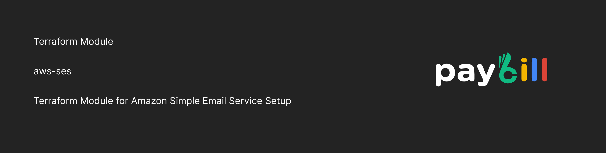

  <a href="https://paybill.dev" target="_blank">
    <picture>
      
    </picture>
  </a>

### AWS SES SMTP IAM Module

This Terraform module provisions the **minimum infrastructure required to send emails through Amazon SES using SMTP credentials**, following AWS best practices for security and secret management.

The module creates a **dedicated IAM user for SES SMTP**, generates access keys, and securely stores the credentials in **AWS Systems Manager Parameter Store** as encrypted `SecureString` parameters. This makes it easy to integrate SES with applications, CI/CD pipelines, and third-party tools without hardcoding secrets.

---

### What This Module Creates

* **IAM User** dedicated to SES SMTP email sending
* **SES permissions** attached to the user (AmazonSESFullAccess)
* **IAM access keys** used as SMTP credentials
* **Secure storage of credentials** in AWS SSM Parameter Store

  * Access Key ID
  * Secret Access Key
* **Outputs** for referencing the IAM user and SSM parameter names

---

### Why This Module Exists

Sending email via SES over SMTP requires IAM credentials that must be:

* Isolated per environment (dev / stage / prod)
* Securely stored and rotated
* Accessible by applications without exposing secrets in code

This module standardizes that setup and integrates cleanly with:

* Containerized workloads (ECS, EKS)
* EC2-based services
* CI/CD pipelines
* SaaS platforms using transactional email

---

### Security Considerations

* Credentials are stored as **SSM SecureString parameters**
* IAM user is scoped specifically for SES usage
* Environment and namespace naming ensure isolation across deployments
* Compatible with secret rotation strategies via SSM

---

<!-- BEGIN_TF_DOCS -->
## Requirements

No requirements.

## Providers

| Name | Version |
|------|---------|
|  [aws](#provider\_aws) | n/a |

## Modules

No modules.

## Resources

| Name | Type |
|------|------|
| [aws_iam_access_key.ses_smtp_key](https://registry.terraform.io/providers/hashicorp/aws/latest/docs/resources/iam_access_key) | resource |
| [aws_iam_user.ses_smtp_user](https://registry.terraform.io/providers/hashicorp/aws/latest/docs/resources/iam_user) | resource |
| [aws_iam_user_policy_attachment.ses_policy](https://registry.terraform.io/providers/hashicorp/aws/latest/docs/resources/iam_user_policy_attachment) | resource |
| [aws_ssm_parameter.ses_access_key](https://registry.terraform.io/providers/hashicorp/aws/latest/docs/resources/ssm_parameter) | resource |
| [aws_ssm_parameter.ses_secret_access_key](https://registry.terraform.io/providers/hashicorp/aws/latest/docs/resources/ssm_parameter) | resource |

## Inputs

| Name | Description | Type | Default | Required |
|------|-------------|------|---------|:--------:|
|  [environment](#input\_environment) | Name of the environment, i.e. dev, stage, prod | `string` | `"dev"` | no |
|  [namespace](#input\_namespace) | Namespace of the project | `string` | `"platform-api"` | no |
|  [region](#input\_region) | AWS Region | `string` | `"us-east-1"` | no |

## Outputs

| Name | Description |
|------|-------------|
|  [ses\_access\_key\_param](#output\_ses\_access\_key\_param) | n/a |
|  [ses\_secret\_access\_key\_param](#output\_ses\_secret\_access\_key\_param) | n/a |
|  [ses\_smtp\_user](#output\_ses\_smtp\_user) | n/a |
<!-- END_TF_DOCS -->